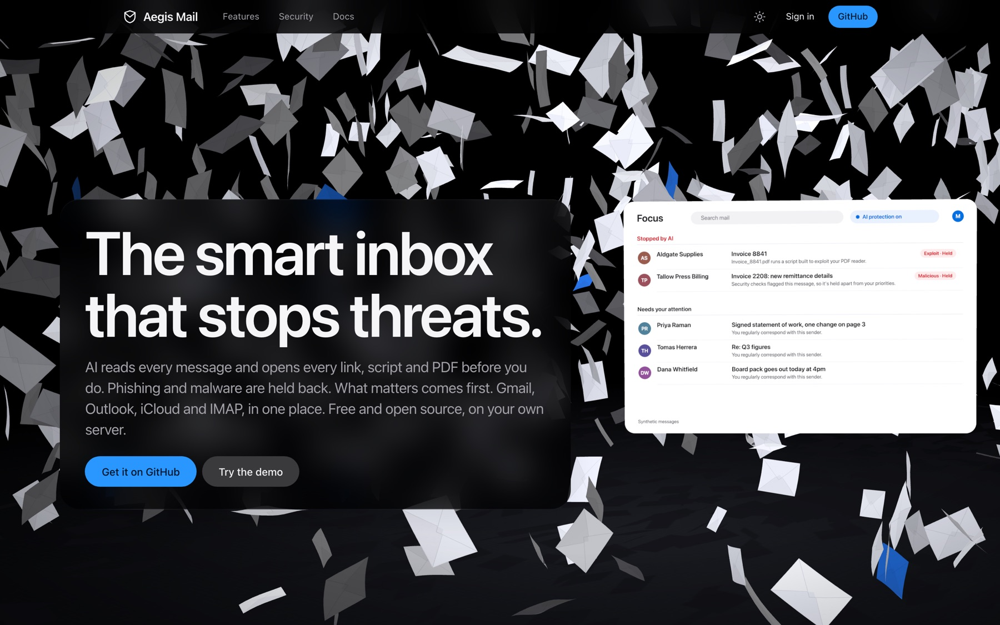
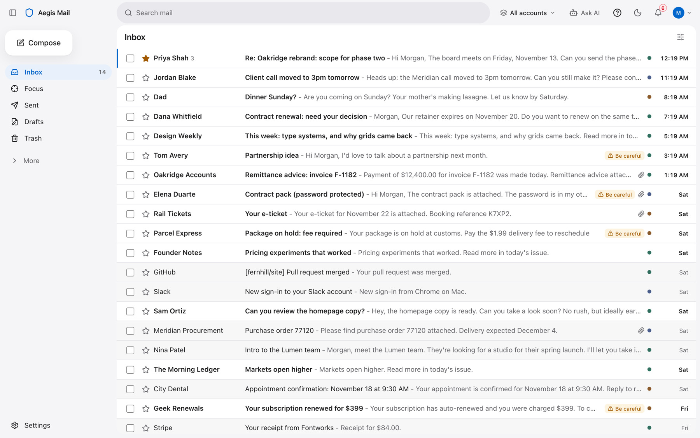
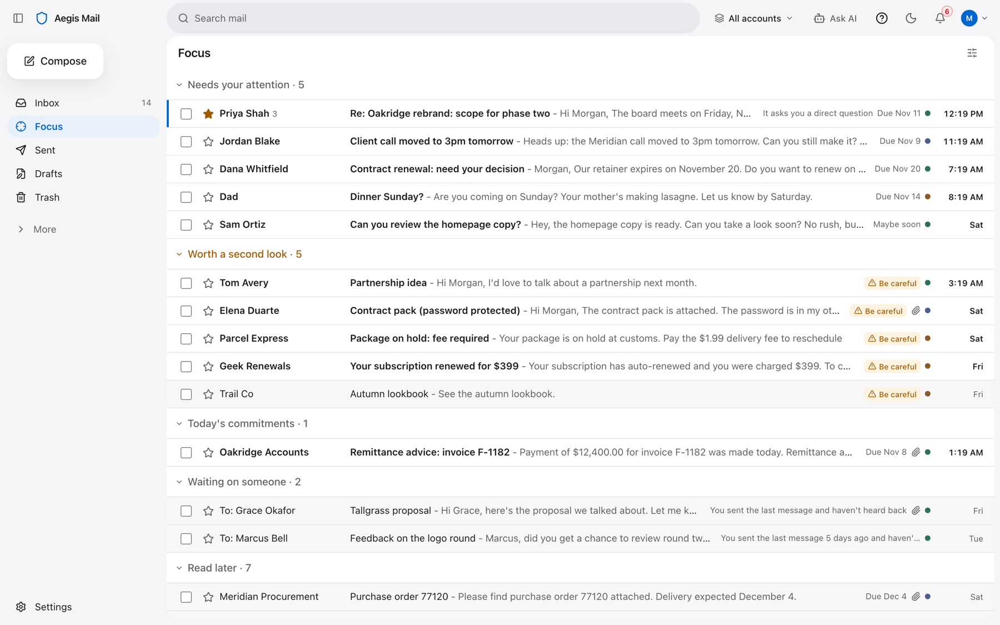
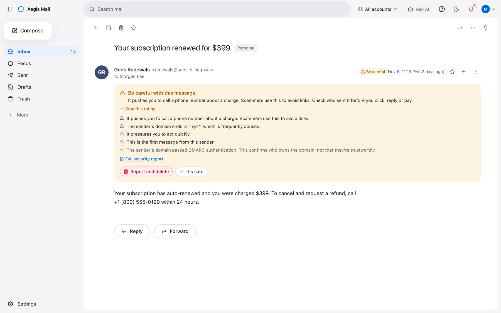
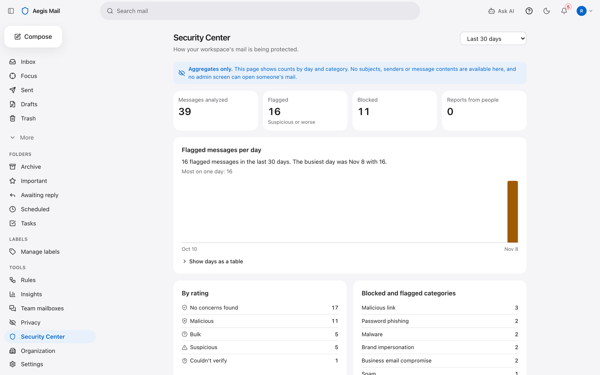

<div align="center">


# Aegis Mail

**The smart inbox that stops threats. On your own server.**

AI reads every message and opens every link, script and PDF before you do. Phishing and malware are held back, and what matters comes first. Gmail, Outlook, iCloud and IMAP, in one place.

[](LICENSE)
[](https://github.com/brstic/aegis-mail/actions/workflows/ci.yml)
[](docs/self-hosting.md)
[](tsconfig.base.json)
[](apps/web)
[](packages/db/migrations)
[](package.json)
[](CONTRIBUTING.md)

[**Self-host it**](#self-hosting) · [Features](#features) · [Screenshots](#screenshots) · [Development](#development) · [Docs](#documentation)

<br>



</div>

<br>

## Why Aegis Mail

- 🛡️ **Protection that explains itself.** Every message gets a rating and the reasons behind it, in plain words. Dangerous mail is held out of the inbox, reversibly.
- 🎯 **Focus, not noise.** Mail is ranked by who it's from and what it asks, *after* security analysis, so a scam can't shout "URGENT" its way to the top.
- 🔐 **Your server, your keys.** Message content is encrypted under per-workspace keys, wrapped by a root key you hold. Admins can't read members' mail, and the database enforces it.
- 🧠 **AI that stays home by default.** Summaries, tasks and drafts work with local rules that never send mail anywhere. A hosted model is opt-in, per person.
- 📬 **Every mailbox in one place.** Gmail and Microsoft 365 over OAuth, iCloud, Fastmail, Yahoo or any IMAP server, with the sending account always shown.

## Screenshots

<table>
  <tr>
    <td width="50%">
      <picture>
        <source media="(prefers-color-scheme: dark)" srcset="docs/images/inbox-dark.png">
        
      </picture>
      <p align="center"><b>One inbox</b> for all your accounts. Suspicious mail is marked right in the list.</p>
    </td>
    <td width="50%">
      <picture>
        <source media="(prefers-color-scheme: dark)" srcset="docs/images/focus-dark.png">
        
      </picture>
      <p align="center"><b>Focus</b> sorts what needs you from what can wait, with a reason on every row.</p>
    </td>
  </tr>
  <tr>
    <td width="50%">
      <picture>
        <source media="(prefers-color-scheme: dark)" srcset="docs/images/threat-dark.png">
        
      </picture>
      <p align="center"><b>Why this rating:</b> the evidence behind every warning, and one click to report it.</p>
    </td>
    <td width="50%">
      
      <p align="center"><b>Security Center</b> for organizations: trends and categories, never anyone's mail.</p>
    </td>
  </tr>
</table>

<sub>All mail in the screenshots is synthetic demo data.</sub>

## Features

| | |
|---|---|
| **Message security** | SPF, DKIM and DMARC results, lookalike domains, mismatched and disguised links, QR codes, invoice and payment-change fraud, CEO impersonation, and hidden instructions aimed at AI. Every rating comes with its reasons. |
| **Attachment inspection** | PDFs are decoded and checked for JavaScript, auto-run and launch actions and embedded files; Office files for macros, remote templates and DDE; RTF, HTML and SVG for exploits, sign-in forms and smuggling. Optional ClamAV scanning, included in the Docker stack. |
| **Focus** | Ranking by sender relationship and what the message asks, applied after security analysis. Every row answers "why am I seeing this?". |
| **Search** | Gmail-style operators (`from:`, `to:`, `subject:`, `has:attachment`, `is:unread`, `before:`, `after:`, `label:` and more), plus optional semantic search with a small model that runs on your server. |
| **Summaries, tasks and drafts** | Local rules by default. With an Anthropic API key, and only for people who turn it on, a hosted model writes summaries and drafts and adds a second opinion on suspicious mail. Nothing is sent without your approval. |
| **Rules and automations** | Plain-English or form-based rules with a dry run, an approval queue and limits. |
| **Organizations** | Roles, policies, verified domains, OIDC and SAML single sign-on, SCIM provisioning, delegated and shared mailboxes, an audit log, and a Security Center built on aggregates only. |
| **Accounts** | Passwords (Argon2id), passkeys, and authenticator apps with recovery codes. Sign-up is by invitation on a production server. |
| **Privacy Center** | Shows what is stored and who can read it, with export and deletion. |
| **Browser extension** | Experimental (`apps/extension`): marks risky links in webmail, entirely on your device. |

What has been tested, and how, is in [`docs/STATUS.md`](docs/STATUS.md). Read it before you rely on any of the above. In particular, the Gmail, Microsoft and (optional) AWS KMS integrations have been tested against protocol fakes and local servers, not the live services.

## Self-hosting

You need a Linux server with Docker and Docker Compose v2 (8 GB of memory is comfortable, mostly for ClamAV) and a domain name with a TLS reverse proxy. An SMTP relay for verification and password-reset mail is strongly recommended.

```sh
git clone https://github.com/brstic/aegis-mail.git && cd aegis-mail
cp infra/docker/selfhost.env.example .env && chmod 600 .env
# Edit .env: APP_ORIGIN, WEBAUTHN_RP_ID, the three database passwords, the SMTP relay, and the root key:
#   AEGIS_ROOT_KEY=$(openssl rand -base64 32)   (back it up separately; never change it)
docker compose up -d --build
```

This builds the images and starts PostgreSQL, ClamAV, a migration step, the web app and the worker, from [`compose.yaml`](compose.yaml). The web app listens on `127.0.0.1:3000`; point your reverse proxy at it.

**First user.** Open your `APP_ORIGIN`, choose **Sign up**, and create a personal workspace or an organization. You become its owner. Confirm your address from the email (this needs the SMTP relay), then add an authenticator app or a passkey under Settings, Security. After the first account, sign-up is by invitation unless you set `AEGIS_SIGNUP=open`.

**Connect mail.** In the app, go to Connect. IMAP and SMTP mailboxes work with no server setup: use an app password. Gmail and Outlook need your own OAuth clients:

| Provider | Register | Redirect URI | Scopes | Settings |
|---|---|---|---|---|
| Gmail | Google Cloud project, Gmail API enabled, OAuth client of type "Web application" | `<APP_ORIGIN>/api/v1/oauth/gmail/callback` | `gmail.modify` (or `gmail.readonly` for read-only) | `GOOGLE_CLIENT_ID`, `GOOGLE_CLIENT_SECRET` |
| Outlook, Microsoft 365 | Microsoft Entra app registration, any organization and personal accounts, platform "Web" | `<APP_ORIGIN>/api/v1/oauth/microsoft/callback` | Delegated `Mail.ReadWrite`, `Mail.Send`, `offline_access`, `User.Read` (or `Mail.Read` for read-only) | `MICROSOFT_CLIENT_ID`, `MICROSOFT_CLIENT_SECRET` |

A Google app in **Testing** status works for up to 100 test users that you list. Beyond that, Gmail's restricted scopes need Google's verification. Push notifications (Gmail through Pub/Sub, Microsoft through Graph subscriptions) are optional; without them, mailboxes are polled.

The full guide, with every setting, the reverse proxy, backups and upgrades, is [`docs/self-hosting.md`](docs/self-hosting.md).

> [!TIP]
> **Just looking?** `docker compose -f infra/docker/compose.yml up --build` runs a local demo with synthetic mail at http://localhost:3000. Never expose it: its logins are public.

## How it works

```
 Gmail · Microsoft 365 · IMAP ──▶ worker ──▶ security engine ──▶ Focus ranking ──▶ PostgreSQL (encrypted at rest)
                                    │              │                                     ▲
                                    │              └─ attachments, links, ClamAV         │
                                    └─ job queue in PostgreSQL                 web app + /api/v1 ◀── you
```

A Next.js app (`apps/web`) serves the UI and the `/api/v1` API. A worker (`apps/worker`) syncs mailboxes, runs analysis and sends mail through a job queue in PostgreSQL. The two log in to the database as separate roles, and only the worker can read mailbox credentials. Row-level security keeps each person to their own mail. Business logic lives in `packages/*`: `security-engine`, `mail-adapters`, `mail-parser`, `ai-core`, `cryptography`, `db`, `domain` and `platform`. More in [`docs/architecture.md`](docs/architecture.md).

## Development

Needs Node 22 or newer, pnpm 9 and PostgreSQL 16 or newer on localhost.

```sh
cp .env.example .env
pnpm bootstrap   # install, create the database, migrate, seed the synthetic demo
pnpm dev         # web on http://localhost:3000, and the worker
```

Open http://localhost:3000/sign-in and choose **Try the demo**. All demo mail is synthetic and nothing is really sent.

```sh
pnpm test        # unit, integration and security tests (vitest; needs local Postgres, creates aegis_test_* databases)
pnpm typecheck
pnpm test:e2e    # Playwright against a production build, in its own aegis_e2e database
pnpm eval        # detection evaluation, written to docs/eval-report.md
```

See [CONTRIBUTING.md](CONTRIBUTING.md) for conventions, and [SECURITY.md](SECURITY.md) to report a vulnerability privately.

## Documentation

- [`docs/self-hosting.md`](docs/self-hosting.md): deployment, configuration reference, backups, upgrades
- [`docs/STATUS.md`](docs/STATUS.md): what works, and what it has been tested against
- [`docs/architecture.md`](docs/architecture.md), [`docs/threat-model/`](docs/threat-model/README.md), [`docs/privacy-modes.md`](docs/privacy-modes.md), [`docs/adr/`](docs/adr/README.md)
- [`docs/runbooks/`](docs/runbooks): backup and restore, operators, incident response, provider testing
- [`docs/openapi.json`](docs/openapi.json): the HTTP API

## License

Aegis Mail is free software: you can redistribute it and modify it under the terms of the [GNU Affero General Public License, version 3](LICENSE), as published by the Free Software Foundation. If you run a modified version for other people over a network, the AGPL requires you to offer them its source code.

<sub>"Aegis Mail" is a working name and may change.</sub>
